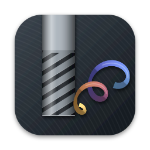
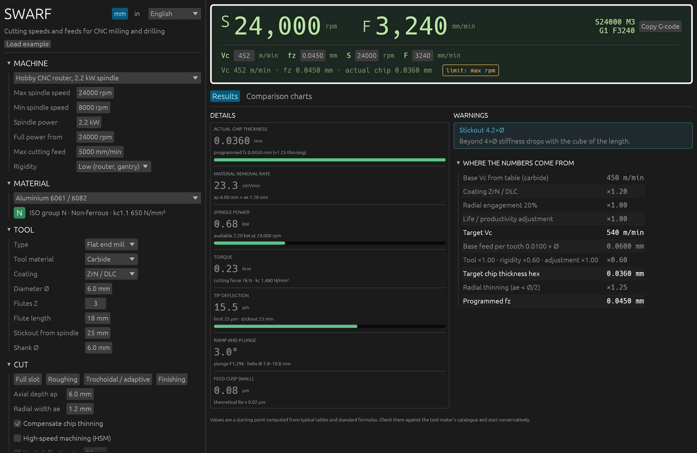
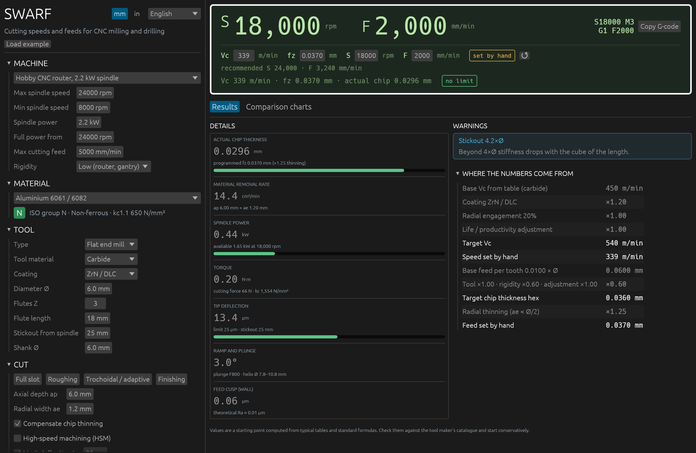
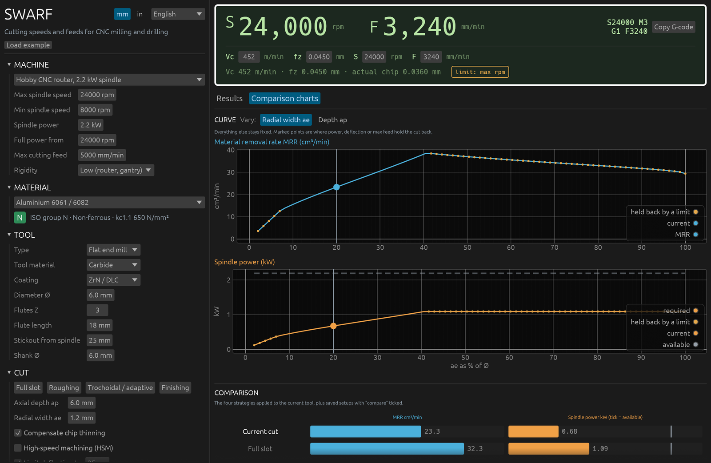

<p align="center">
  
</p>

<h1 align="center">Swarf</h1>

<p align="center">
  Speeds and feeds calculator for CNC milling and drilling.<br>
  Free, open source, runs on macOS, Linux and Windows.
</p>

<p align="center">
  <a href="https://github.com/TinyWorkshopDesign/swarf/actions/workflows/build.yml"></a>
  <a href="https://github.com/TinyWorkshopDesign/swarf/releases/latest"></a>
  <a href="LICENSE"></a>
</p>



Pick your machine, material, tool and cut. Swarf gives you spindle speed and feed, explains every factor behind them, and warns you before the tool deflects, the spindle runs out of power or the chip gets too thin to cut.

## Features

- **Speeds and feeds** for flat, ball, bull-nose and V-bit end mills, indexable face mills and twist drills, in 25 materials across the ISO groups (aluminium, steels, stainless, cast iron, titanium, superalloys, hardened steel, plastics, wood).
- **Chip thinning** compensation for narrow stepovers, shallow ball-nose cuts and lead angles.
- **High-speed machining (HSM)** option for trochoidal and adaptive toolpaths: cutting speed rises at low radial engagement.
- **Workpiece hardness** input for steels, stainless, cast irons, superalloys and hardened steel: cutting speed follows the difference from nominal.
- **Cutting power, torque and force** from the Kienzle model, with the spindle's real power curve (power drops below base speed).
- **Tool deflection** of shank and flutes, with a limit you set.
- **Automatic limits**: feed is lowered when power, deflection or the machine's max feed would be exceeded, and the display shows which one applied.
- **Where the numbers come from**: every multiplier from table value to programmed feed, step by step.
- **Comparison charts**: material removal rate and spindle power while radial width `ae` or depth `ap` changes, and side-by-side bars for full slot, roughing, trochoidal and finishing strategies plus your saved setups.
- **Set speed and feed by hand**: type or drag Vc, fz, spindle speed or feed in the display; the linked value follows (Vc ↔ S, fz ↔ F), the recommended values stay in view and one click brings them back.
- **Metric or inch**: mm, m/min, mm/min, kW or in, SFM, in/min, hp, with G20 in the G-code. The default follows your system's region.
- **Ready G-code** (`S… M3`, `G1 F…`, `G81`/`G83` for drilling) with a copy button.
- **Saved setups** library, kept between sessions.
- **8 languages**: English, Italiano, Deutsch, Français, Español, 简体中文, 日本語, 한국어. The language follows your system and can be changed from the menu.





## Download

Get the latest build for your system from the [Releases page](https://github.com/TinyWorkshopDesign/swarf/releases/latest):

| System | File | How to run |
|---|---|---|
| macOS | `Swarf-…-macos.dmg` | Open the disk image and drag **Swarf** into Applications. The app is not signed: the first time, right-click it and choose **Open**. A portable `…-macos.zip` is also provided. |
| Windows 10/11 (64-bit) | `Swarf-…-windows-x64-setup.exe` | Run the installer. If SmartScreen warns about an unknown publisher, choose **More info → Run anyway**. A portable `…-windows-x64.zip` is also provided. |
| Debian / Ubuntu | `Swarf-…-linux-x64.deb` | `sudo apt install ./Swarf-…-linux-x64.deb` |
| Fedora / openSUSE | `Swarf-…-linux-x64.rpm` | `sudo dnf install ./Swarf-…-linux-x64.rpm` (or `zypper install`) |
| Any Linux | `Swarf-…-linux-x64.AppImage` | `chmod +x Swarf-…-linux-x64.AppImage` and run it. A portable `…-linux-x64.tar.gz` is also provided. |

Chinese, Japanese and Korean need a CJK font such as `fonts-noto-cjk`.

## Build from source

Install Rust 1.95 or newer from [rustup.rs](https://rustup.rs), then:

```bash
git clone https://github.com/TinyWorkshopDesign/swarf.git
```

```bash
cd swarf
```

```bash
cargo run --release
```

On Debian or Ubuntu, install the windowing and OpenGL libraries first:

```bash
sudo apt install libxkbcommon-dev libgl1-mesa-dev libwayland-dev libx11-dev libxcursor-dev libxrandr-dev libxi-dev
```

Run the tests:

```bash
cargo test
```

### Packaging

- **macOS app bundle**: `./scripts/bundle_macos.sh` writes `target/release/Swarf.app`. Set `BUNDLE_ID` to your own reverse-domain identifier when distributing.
- **Windows from a Mac**: with MinGW (`brew install mingw-w64`), `cargo build --release --target x86_64-pc-windows-gnu`. The icon is embedded by `build.rs`.
- **Linux desktop entry**: copy `assets/swarf.desktop` to `~/.local/share/applications/` and `assets/icon-256.png` to `~/.local/share/icons/hicolor/256x256/apps/swarf.png`.
- **Windows installer**: `scripts/installer.nsi` is an [NSIS](https://nsis.sourceforge.io) script; `makensis /DVERSION=<tag> /DROOT=<repo root> scripts/installer.nsi` writes the setup `.exe`. The icon comes from `assets/icon.ico`.
- **Screenshots**: `SWARF_SCREENSHOT=docs/screenshots cargo run --release` starts from a clean state (your settings are not read or changed), saves `results.png`, `charts.png` and `manual.png` in that folder and quits.
- **Releases**: pushing a tag such as `v0.1.0` runs `.github/workflows/release.yml`, which builds every platform and attaches a macOS `.dmg` (universal), a Windows `setup.exe`, and Linux `.deb`, `.rpm` and `.AppImage` (plus portable archives) to a GitHub release.

## How the numbers are computed

| Step | Model |
|---|---|
| Cutting speed | Handbook Vc per material and tool material, scaled by coating, by workpiece hardness (Sandvik Coromant factors), by 0.9 in a full slot and, with HSM on, by radial engagement (Kennametal factors: ×1.4 at 10 %) |
| Feed per tooth | Material factor × diameter, scaled by tool material and machine rigidity; −20 % in a full slot (Kennametal) |
| Drilling | Vc as a fraction of the end mill speed and feed per rev 2.5 × cf × Ø, both per material group from the Kennametal GOdrill tables |
| Chip thinning | Radial: `1 / (2·√(ae/D − (ae/D)²))` when ae < D/2; lead angle and ball nose: `1 / sin κ` |
| Specific cutting force | Kienzle: `kc = kc1.1 · hm^−mc · (1 − γ/100)`, with mean chip thickness `hm` from the engagement angle and a typical end mill rake angle γ per material group (Sandvik Coromant) |
| Power | Milling `Pc = ap·ae·vf·kc / 6·10⁷` kW; drilling `Pc = f·vc·D·kc / 240 000` kW; spindle efficiency 0.85 |
| Deflection | Cantilever of shank (Ø shank) and flutes (0.8·Ø) under the tangential cutting force |

Material data are typical values from machining handbooks, in `src/data.rs`. **They are a starting point.** Check them against your tool maker's catalogue, start conservatively and listen to the cut.

## Code layout

| File | Contents |
|---|---|
| `src/calc.rs` | Calculation engine: pure, no UI and no text, with tests |
| `src/data.rs` | Materials, coatings, machine presets, strategies |
| `src/i18n.rs` | Translations and number formatting per language |
| `src/units.rs` | Metric and inch conversions for display and input |
| `src/fonts.rs` | Loads CJK fonts from the system only when needed |
| `src/app.rs` | egui interface, DRO display, charts |
| `src/main.rs` | Window start-up and icon |
| `assets/` | Icon in every format and the Linux `.desktop` file |
| `scripts/make_icon.py` | Regenerates every icon file (needs `rsvg-convert` and Pillow) |
| `scripts/bundle_macos.sh` | Builds `Swarf.app` |
| `scripts/installer.nsi` | NSIS script for the Windows setup `.exe` |
| `prototipo/truciolo.html` | The first web prototype, kept for reference |
| `ROADMAP.md` | Planned updates |

## Contributing

Issues and pull requests are welcome, especially:

- cutting data you have verified on real machines, with material, tool and result;
- new materials, coatings or tool types;
- translations and corrections by native speakers.

To add a language: add a variant to `Lang` in `src/i18n.rs` and to `Lang::ALL`, raise `LANG_COUNT`, add one column to every entry of the `strings!` table and to `material_name` (the compiler lists every missing entry), then set its separators and locale code. Only left-to-right scripts are supported.

Please run `cargo fmt` and `cargo test` before opening a pull request.

## Settings location

Settings and saved setups are stored in:

- macOS: `~/Library/Application Support/swarf`
- Linux: `~/.local/share/swarf`
- Windows: `%APPDATA%\swarf\data`

## License

Swarf is free software: you can redistribute it and/or modify it under the terms of the [GNU General Public License](LICENSE) as published by the Free Software Foundation, either version 3 of the License, or (at your option) any later version.

Swarf is distributed in the hope that it will be useful, but **without any warranty**; without even the implied warranty of merchantability or fitness for a particular purpose. Cutting parameters are estimates: you are responsible for the safe operation of your machine.
